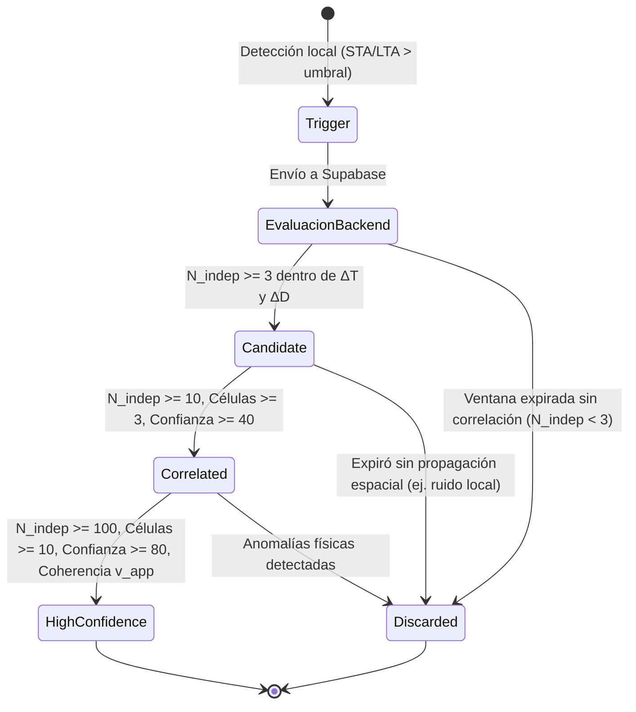

# QuakeNet — Modelo Matemático y Arquitectura de Consenso Sísmico Distribuido (Fase 2C.1)

## 1. Principio Fundamental y Filosofía Científica

QuakeNet es una red ciudadana de detección sísmica participativa basada en acelerómetros MEMS integrados en teléfonos móviles.

### Premisas Clave:
1. **NO predicción:** El sistema no predice terremotos. Detecta ondas sísmicas en tiempo real una vez iniciado el evento mediante el principio de Alerta Temprana (EEW: *Earthquake Early Warning*).
2. **MEMS de consumo no son sismómetros de observatorio:** Los sensores móviles poseen menor relación señal/ruido (SNR), sufren interferencias antropogénicas locales (pisadas, tráfico, caídas, movimiento humano) y presentan variabilidad en sus relojes internos (NTP jitter de $\pm 50 \text{ ms}$ hasta $\pm 2 \text{ s}$).
3. **Consenso distribuido estricto:** Un evento nunca se declara por un solo nodo ni por acumulación de nodos en un único punto geográfico (e.g. 100 teléfonos en el mismo edificio). Requiere coherencia espacio-temporal, independencia física y física de propagación de ondas elásticas.

---

## 2. Definición Formal de Entidades y Estados



### Estados del Evento:
* **`candidate` (Candidato Preliminar):** Agrupación incipiente de al menos 3 nodos independientes en una ventana espacio-temporal compatible ($\Delta T \le 15\text{ s}$, $\Delta D \le 50\text{ km}$).
* **`correlated` (Evento Correlacionado):** Consenso confirmado con dispersión espacial real ($\ge 10$ nodos independientes distribuidos en $\ge 3$ macro-células geográficas separadas por más de 2 km) y puntuación de confianza $C \ge 40$.
* **`high_confidence` (Alta Confianza Distribuida):** Superación del umbral experimental de referencia ($\ge 100$ nodos independientes, $\ge 10$ macro-células separadas por $> 10\text{ km}$, $C \ge 80$) con coherencia cinemática de propagación de onda elástica ($1.5 \le v_{app} \le 9.0\text{ km/s}$).
* **`discarded` (Descartado):** Triggers aislados cuya ventana temporal de 60 segundos expiró sin alcanzar consenso, o eventos candidatos confinados a una única micro-ubicación (falsa alarma local).

---

## 3. Modelo Matemático de Correlación

### 3.1. Correlación Espacio-Temporal y Cinemática de Onda

La propagación de ondas sísmicas a través de la corteza continental terrestre obedece a velocidades elásticas acotadas:
* Ondas Primarias P (compresionales): $v_p \in [5.0, 8.0] \text{ km/s}$
* Ondas Secundarias S (cizalla): $v_s \in [3.0, 4.5] \text{ km/s}$
* Ondas Superficiales (Rayleigh/Love): $v_{surf} \in [1.8, 3.5] \text{ km/s}$

Para dos triggers cualesquiera $i$ y $j$ detectados en momentos $t_i$ y $t_j$ con coordenadas $(\phi_i, \lambda_i)$ y $(\phi_j, \lambda_j)$:
$$\Delta d(i, j) = \text{GeodesicDistance}((\phi_i, \lambda_i), (\phi_j, \lambda_j))$$
$$\Delta t(i, j) = |t_i - t_j|$$

La velocidad aparente inter-estación se define como:
$$v_{app}(i, j) = \frac{\Delta d(i, j)}{\Delta t(i, j)}$$

#### Criterio de Coherencia Cinemática:
1. **Triggers muy cercanos ($\Delta d \le 2\text{ km}$):** Se permite $\Delta t \le 3.0\text{ s}$ para absorber desfases de sincronización de reloj NTP de Android.
2. **Triggers a distancia intermedia o lejana ($\Delta d > 2\text{ km}$):** La velocidad aparente debe satisfacer:
   $$v_{min} \le v_{app}(i, j) \le v_{max}$$
   Donde:
   * $v_{min} = 1.2 \text{ km/s}$ (límite inferior para dispersión en sedimentos blandos y retardo de detección STA/LTA).
   * $v_{max} = 9.5 \text{ km/s}$ (límite superior para ondas P refractadas en Moho con tolerancia a reloj).

> [!IMPORTANT]
> Si dos triggers separados por $30\text{ km}$ reportan detección con diferencia de $0.05\text{ s}$ ($v_{app} = 600\text{ km/s}$), dicha pareja es físicamente imposible para un frente de onda elástico y se penaliza como ruido coincidente o perturbación electromagnética/red.

---

### 3.2. Independencia de Nodos y Atenuación de Concentración Local (Anti-Edificio)

Un problema clásico de la sismología móvil ciudadana es el "efecto edificio": 50 personas en una misma oficina o concierto saltando o sintiendo un camión pesado pasar.

Para garantizar verdadera independencia espacial:
1. **Agrupación en Células Geográficas (Spatial Hashing):**
   El espacio se discretiza en cuadrículas de resolución $\approx 500\text{ m}$ (aproximadamente Geohash de 6 caracteres o celda de $0.005^\circ$).
2. **Función de Peso por Célula:**
   Si una célula $c$ contiene $n_c$ triggers de dispositivos distintos, el peso efectivo de independencia aportado por dicha célula es sublineal:
   $$w(n_c) = \begin{cases}
   1.0 & n_c = 1 \\
   1.0 + 0.3 \cdot \ln(n_c) & n_c > 1
   \end{cases}$$
   *Ejemplo numérico:*
   * 1 teléfono en el edificio: aporta $1.0$ nodo independiente.
   * 10 teléfonos en el mismo edificio: aportan $1.0 + 0.3 \cdot \ln(10) \approx 1.69$ nodos equivalentes.
   * 100 teléfonos en el mismo edificio: aportan $1.0 + 0.3 \cdot \ln(100) \approx 2.38$ nodos equivalentes.

El conteo global de **Nodos Independientes ($N_{indep}$)** para un evento compuesto por $K$ células activas es:
$$N_{indep} = \sum_{c=1}^K w(n_c)$$

> [!NOTE]
> De esta forma, es matemáticamente imposible alcanzar el umbral de alta confianza ($N_{indep} \ge 100$) si todos los teléfonos están concentrados en una misma zona o edificio.

---

### 3.3. Ponderación por Calidad de Señal ($Q_i$)

Cada trigger $i$ recibido posee métricas de procesamiento local. Su factor de calidad $Q_i \in [0.0, 1.0]$ se calcula como:
$$Q_i = 0.40 \cdot \psi_{ratio}(r_i) + 0.30 \cdot \psi_{acc}(a_i) + 0.30 \cdot \psi_{gps}(\sigma_i)$$

#### 1. Factor de Ratio STA/LTA ($\psi_{ratio}$):
* Umbral base de detección: $r_{min} = 3.0$
* Saturación de alta confianza: $r_{sat} = 15.0$
$$\psi_{ratio}(r_i) = \min\left(1.0, \max\left(0.1, \frac{r_i - 3.0}{12.0}\right)\right)$$

#### 2. Factor de Magnitud Pico ($\psi_{acc}$):
Aceleraciones compatibles con sismos perceptibles oscilan entre $0.02\text{ g}$ ($0.2\text{ m/s}^2$) y $1.2\text{ g}$.
Spikes superiores a $2.5\text{ g}$ suelen representar caídas directas del teléfono al suelo o impactos mecánicos.
$$\psi_{acc}(a_i) = \begin{cases}
0.3 & a_i < 0.01\text{ g} \\
1.0 & 0.01\text{ g} \le a_i \le 1.2\text{ g} \\
\max(0.1, 1.0 - \frac{a_i - 1.2}{1.8}) & a_i > 1.2\text{ g}
\end{cases}$$

#### 3. Factor de Precisión GPS ($\psi_{gps}$):
* $\sigma_i \le 50\text{ m}$: $\psi_{gps} = 1.0$ (fijación satelital óptima).
* $50\text{ m} < \sigma_i \le 200\text{ m}$: $\psi_{gps} = 0.8$.
* $200\text{ m} < \sigma_i \le 1000\text{ m}$: $\psi_{gps} = 0.5$.
* Sin GPS / $\sigma_i > 1000\text{ m}$: $\psi_{gps} = 0.2$ (participa como nodo de soporte temporal, pero no puede anclar centroide).

---

### 3.4. Puntuación de Confianza Compuesta ($C \in [0, 100]$)

La confianza global del evento se evalúa combinando 4 pilares:
$$C = 100 \times \left( 0.35 \cdot \Phi_{volumen} + 0.30 \cdot \Phi_{espacio} + 0.20 \cdot \Phi_{calidad} + 0.15 \cdot \Phi_{tiempo} \right)$$

1. **Factor de Volumen Independiente ($\Phi_{volumen}$):**
   $$\Phi_{volumen} = \min\left(1.0, \frac{N_{indep}}{100.0}\right)$$
2. **Factor de Dispersión Espacial ($\Phi_{espacio}$):**
   Evalúa el número de células geográficas independientes $K$ y el radio de cobertura $R_{km}$:
   $$\Phi_{espacio} = 0.5 \cdot \min\left(1.0, \frac{K}{10.0}\right) + 0.5 \cdot \min\left(1.0, \frac{R_{km}}{30.0}\right)$$
3. **Factor de Calidad Media ($\Phi_{calidad}$):**
   $$\Phi_{calidad} = \frac{1}{M} \sum_{i=1}^M Q_i$$
4. **Factor de Coherencia Temporal ($\Phi_{tiempo}$):**
   Penaliza eventos cuyos triggers están dispersos uniformemente en el tiempo sin frente de onda concentrado:
   $$\Phi_{tiempo} = \max\left(0.1, 1.0 - \frac{\sigma_{temporal}}{7.5}\right)$$

---

## 4. Reglas de Descarte y Protección Contra Falsas Alarmas

1. **Triggers Duplicados (Anti-Spam / Replay):**
   Triggers del mismo `node_id` recibidos dentro de la ventana de cooldown de $15\text{ s}$ son descartados y no incrementan ni $N_{indep}$ ni el conteo de triggers.
2. **Filtro de Desfase Excesivo (Outliers Temporales):**
   Triggers que lleguen con más de 60 segundos de retraso respecto al tiempo de inicio del evento se encolan para auditoría pero no alteran la clasificación en tiempo real.
3. **Triggers sin Ubicación:**
   Pueden vincularse a un evento existente si coinciden en la ventana temporal, incrementando marginalmente la calidad temporal, pero su peso espacial es nulo ($w=0$ para $\Phi_{espacio}$).
4. **Descarte por Aislamiento:**
   Cualquier trigger pendiente que tras 60 segundos no haya encontrado al menos 2 pares compatibles dentro de su radio geográfico se marca automáticamente como `discarded`.

---

## 5. Pseudocódigo del Algoritmo de Correlación

```text
ALGORITMO CorrelacionDistribuidaQuakeNet:
    ENTRADA: Lista de triggers no procesados T_unprocessed
    
    Adquirir cerrojo exclusivo de correlación (PostgreSQL Advisory Lock)
    
    PARA CADA trigger t EN T_unprocessed:
        // 1. Buscar eventos candidatos activos en ventana espacio-temporal
        EventosCercanos = BUSCAR seismic_events DONDE:
            status EN ('candidate', 'correlated')
            Y detected_at ENTRE (t.detected_at - 15s) Y (t.detected_at + 15s)
            Y (t.geom ES NULL O ST_DWithin(geom, t.geom, 50000m))
            
        SI EventosCercanos NO ESTA VACIO:
            evento = SELECCIONAR EventosCercanos CON menor distancia_tiempo
            ASOCIAR t A evento
        SINO:
            // 2. Buscar otros triggers pendientes compatibles para formar nuevo cluster
            ParesCompatibles = BUSCAR triggers DONDE:
                id != t.id Y event_id ES NULL
                Y detected_at ENTRE (t.detected_at - 15s) Y (t.detected_at + 15s)
                Y (t.geom ES NULL O ST_DWithin(geom, t.geom, 50000m))
                
            SI Longitud(ParesCompatibles) >= 2:
                evento = CREAR NUEVO seismic_event(status='candidate', detected_at=min_timestamp)
                ASOCIAR t Y ParesCompatibles A evento
                
        SI t FUE ASOCIADO A evento:
            // 3. Recalcular métricas de consenso del evento
            N_indep = CalcularNodosIndependientes(evento)
            C = CalcularPuntuacionConfianza(evento)
            Radio = CalcularRadioCobertura(evento)
            
            // 4. Actualizar estado según umbrales matemáticos
            SI N_indep >= 100 Y C >= 80 Y Células >= 10:
                evento.status = 'high_confidence'
            SINO SI N_indep >= 10 Y C >= 40 Y Células >= 3:
                evento.status = 'correlated'
            SINO:
                evento.status = 'candidate'
                
            ACTUALIZAR evento EN BASE DE DATOS
            
    // 5. Limpieza de triggers obsoletos aislados
    MARCAR triggers ANTIGUOS (>60s) SIN event_id COMO processed=TRUE
    
    Liberar cerrojo exclusivo
FIN ALGORITMO
```

---

## 6. Diagrama de Flujo de Datos

```
[ Acelerómetro ] 
       │
       ▼ (50 Hz / STA/LTA)
[ Trigger Local ]
       │
       ▼ (HTTP POST / RLS anon)
[ public.triggers ] ◄── (PostGIS Point, detected_at, ratio, peak_mag)
       │
       ▼ (Trigger de inserción / Tarea periódica / RPC backend)
[ fn_correlate_triggers() ]
       ├── 1. pg_try_advisory_xact_lock (Garantía de concurrencia e idempotencia)
       ├── 2. Agrupación temporal (ΔT ≤ 15s)
       ├── 3. Agrupación espacial PostGIS ST_DWithin (ΔD ≤ 50km)
       ├── 4. Spatial Hashing de independencia de nodos (Resolución 500m)
       ├── 5. Cálculo de puntuación de confianza multicriterio C ∈ [0, 100]
       │
       ▼
[ public.seismic_events ] ◄── (candidate | correlated | high_confidence | discarded)
```
